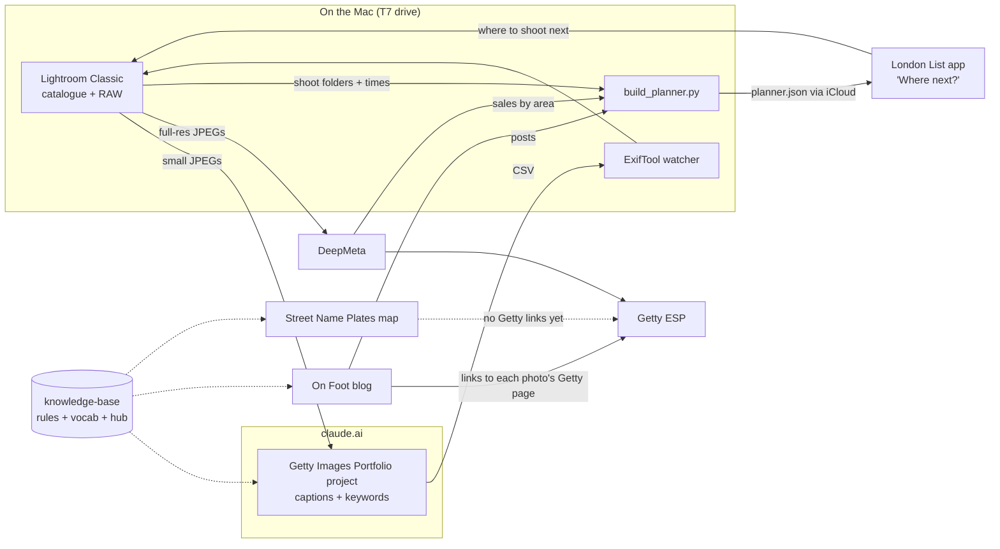

# Project map

How the projects fit together. **Getty sales come first.** Every other project should feed Getty in some way: subjects to shoot, captions with context, or buyers finding the pictures.

| Repo | What it is | Role for Getty | State (27 Nov 2026) |
|---|---|---|---|
| [on-foot-blog](https://github.com/gpmdyg9b4z-spec/on-foot-blog) | Walking-tour blog on GitHub Pages, 51 walks, 336 photos | Shop window: 263 photos link to their Getty page. Walk notes carry the history that Getty captions need. | Active (41 commits in November) |
| [london-list](https://github.com/gpmdyg9b4z-spec/london-list) | Phone app: places to visit, with "Where next?" | Picks where to shoot, using past shoots, posts and sales by area | Active |
| [street-name-plates](https://github.com/gpmdyg9b4z-spec/street-name-plates) | Leaflet map of 253 historic London street plates | A niche series that could send map visitors to Getty, but has no Getty links yet | Dormant since March |
| [photo-metadata-tool](https://github.com/gpmdyg9b4z-spec/photo-metadata-tool) | "Getty Metadata Studio" (a claude.ai artifact) | Captions and keywords for Getty: step 2 of the May pipeline | Dormant since May; may be superseded by the Getty project |
| [knowledge-base](https://github.com/gpmdyg9b4z-spec/knowledge-base) | Rules, vocabularies, workflows, and this hub | Source of truth for the rules (once the conflicts are settled) | This hub added November 2026 |
| expert-octo-spoon | Empty private repo ("First-project") | None | Candidate to delete |

Outside GitHub: the **Getty Images Portfolio** project on claude.ai (its own instructions and knowledge base), DeepMeta, Lightroom on the T7, and Instagram @streetnameplates.

## Shared vocabularies (and where copies live)

| Vocabulary | Copies today | Target |
|---|---|---|
| Getty confirmed keywords | `knowledge-base/getty-confirmed-vocabulary.md` (14 May), `photo-metadata-tool/getty-confirmed-vocabulary.md` (13 May, older), Getty project knowledge | One file here; the others link to it |
| Getty caption and keyword rules | `getty/metadata-rules.md`, `getty-keyword-lessons.md`, the metadata tool's prompt, the Getty project instructions, which **disagree** (see review §1) | One rulebook |
| London areas and places | blog `onfoot.py` PLACES, london-list `places.json` and AREA_POINTS, plates `borough`, `london/architecture-vocabulary.md` | One gazetteer here, read by all |
| Pre-1965 boroughs | `london/architecture-vocabulary.md`, `street-name-plates/schema.md` | Same |
